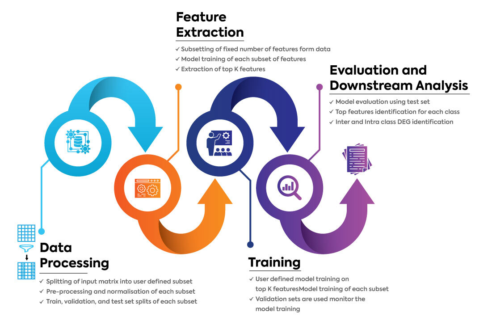

scaLR Documentation
===================

.. include:: ../README.md
   :parser: myst_parser.sphinx_
   :start-line: 2
   :end-line: 24

.. include:: ../README.md
   :parser: myst_parser.sphinx_
   :start-line: 26

.. toctree::
   :maxdepth: 10
   :caption: scaLR Simple API
   :hidden:

   scalr.simple_api

.. toctree::
   :maxdepth: 10
   :caption: scaLR
   :hidden:

   scalr.analysis
   scalr.data
   scalr.feature
   scalr.nn
   scalr.utils

.. toctree::
   :maxdepth: 10
   :caption: Guides
   :hidden:

   guide_simple_api
   guide_cli
   guide_pipeline
   tutorials

.. toctree::
   :maxdepth: 10
   :caption: scaLR Pipelines
   :hidden:

   pipeline
